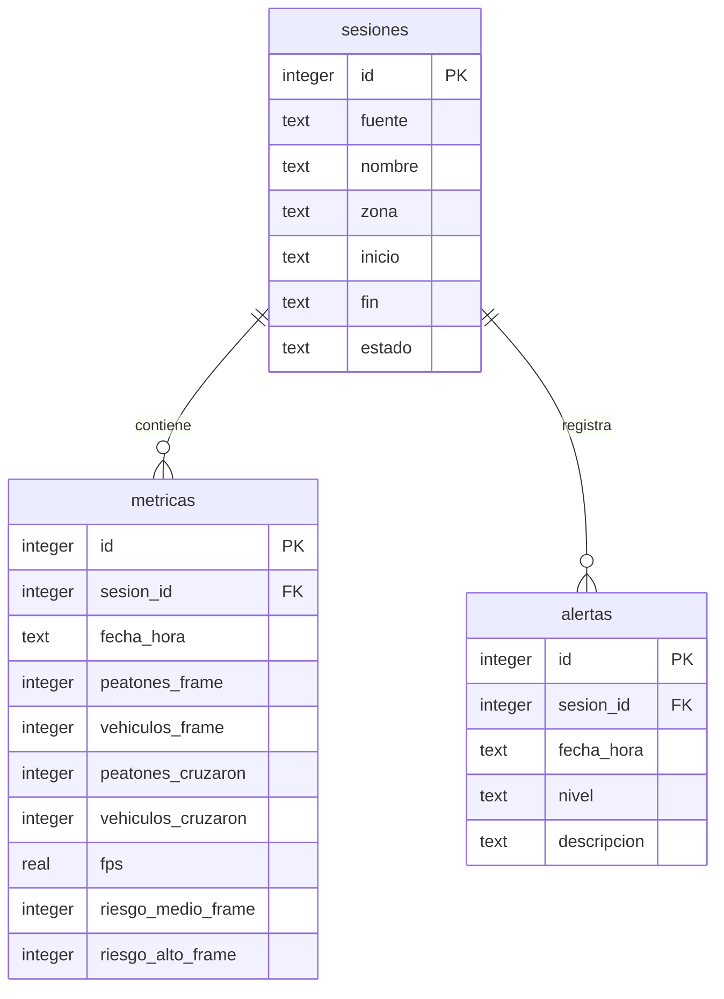

# Persistencia y análisis de datos de SafeWalk

SQLite guarda los datos originales en `outputs/safewalk.db`. Pandas consulta esos registros, agrupa por sesión y minuto y escribe CSV. Los CSV son exportaciones; al descargarlos no se borra ni se reemplaza la base.



Los registros previos sin sesión mantienen `sesion_id=NULL`. La migración agrega la zona sin inventar ubicaciones anteriores. Las conexiones de escritura activan claves foráneas; hay índices por sesión y fecha y una vista `resumen_sesiones`. SQLite usa WAL para permitir lecturas durante el monitoreo.

## Demostración del avance

1. Subir un video e indicar una zona, o conectar la cámara indicando su ubicación.
2. Ver el análisis en vivo y detenerlo para cerrar su sesión.
3. Abrir **Base de datos y explorador de registros**, seleccionar la sesión y consultar métricas y alertas.
4. Filtrar por fechas y riesgo. Los límites de fecha incluyen el día completo en la hora local registrada por el servidor.
5. Descargar el CSV y el ZIP filtrados. Comparar sus registros con los de la tabla.
6. Descargar SQLite, abrirlo con un visor SQLite y ejecutar `database/consultas.sql`.

Para generar la entrega reproducible:

```powershell
.venv\Scripts\python.exe preparar_entrega_datos.py
```

Genera una copia real, una base sintética separada, reportes pandas, esquema SQL y un ZIP en `outputs/entrega_datos`. La base de demostración no se carga automáticamente en el panel ni modifica los registros reales.

No sumes detecciones por fotograma como si fueran personas diferentes. Los cruces son acumulados y el máximo de una selección por fecha no representa necesariamente los cruces dentro de ese intervalo. Las alertas dependen de una heurística visual, no de una probabilidad de accidente validada.

Una sesión que estaba en curso cuando se cerró bruscamente el servidor puede conservar ese estado; no se modifica automáticamente porque podría pertenecer a otra instancia activa.
